<h1 align="center">🍰 Laboratorio 1 de Robótica 🤖</h1>

<h3 align="center">Trayectorias, Entradas y Salidas Digitales</h3>

<p align="center">
  <b>Decoración automática de un pastel con un robot ABB IRB 140 y una banda transportadora</b>
</p>

<p align="center">
  
  
  
  
</p>

<p align="center">
  🎓 Universidad Nacional de Colombia, Robótica 2026-II<br>
  🦾 Robot ABEL del laboratorio<br>
  👥 <b>Integrantes:</b> Marbel Alexandra Garavito Cordero y David Felipe Ruiz Reyes
</p>

<a id="indice"></a>
## 📑 Índice

1. [🤖 Resumen](#resumen)
2. [🖊️ Diseño del portamarcador](#portamarcador)
3. [📐 Work Object en RobotStudio](#workobject)
4. [🎯 Calibración con jogging en el robot ABEL](#calibracion)
5. [✏️ Creación de las trayectorias](#trayectorias)
6. [⚙️ SmartComponents y calibración de la banda](#smartcomponents)
7. [💻 El programa RAPID](#rapid)
8. [🔀 Diagramas de flujo](#diagramas)
9. [📚 Instrucciones y funciones de RAPID utilizadas](#instrucciones)
10. [🎥 Resultados](#resultados)
11. [🛡️ Cómo ejecutarlo y seguridad](#ejecucion)

<a id="resumen"></a>
## 🤖 1. Resumen

En este laboratorio armamos una celda simplificada para decorar un pastel de forma automática. Un robot ABB IRB 140 escribe con un marcador los nombres de los integrantes y traza una decoración sobre un pastel virtual, que en la práctica es una caja que viaja sobre la banda transportadora hasta la estación de trabajo. Cuando la banda se detiene, el robot dibuja, y al terminar el pastel decorado sale por el otro extremo de la banda.

Cada integrante desarrolló su propia rutina en RAPID y su propia simulación en RobotStudio. Las llamamos **Rutina 1** y **Rutina 2**, y las dos tienen la misma importancia: resuelven el mismo laboratorio con enfoques distintos y usan la misma herramienta. Por eso a lo largo del README se presentan lado a lado siempre que se puede.

### 📊 Las dos rutinas en cifras

| Dato | 🅰️ Rutina 1 | 🅱️ Rutina 2 |
|---|---|---|
| 🎯 Targets del módulo | Más de 900, de `Target_10` a `Target_9280`, más `Target_Home`, `Target_Mant` y `Target_WB` | De `Target_9` a `Target_4340`, más `Target_Home` |
| ✏️ Procedimientos de dibujo | 20 trazos, de `Path_10` a `Path_210`, más `Path_120` como punto de seguridad | 161 procedimientos, de `Path_10` a `Path_1620` |
| 📏 Movimientos `MoveL` de dibujo | 698 | 432 |
| ⚡ Velocidad y zona del dibujo | `v300` y `z10` | `v50` y `z10`, con `z1` en tres movimientos |
| 🗺️ Work Object | `Workobject_1` | `Workobject_4` |
| 🔤 Altura de las letras | Unos 11 mm | 40 mm |
| 🚚 Tiempo de entrada del pastel | 4.2 s, unos 605 mm a 144 mm/s | 4.4 s (`T_ENTRADA`) |
| 📦 Tiempo de salida del pastel | 3 s | 4.4 s (`T_SALIDA`) |

La herramienta es la misma para las dos rutinas, y la diferencia entre el TCP virtual y el de la calibración física es de cerca de 8.1 mm.

### 🎛️ Los tres modos de operación

Las dos rutinas se manejan con tres entradas digitales, y solo se atiende un modo a la vez:

| Entrada | Modo | 🅰️ Rutina 1 | 🅱️ Rutina 2 |
|---|---|---|---|
| 🟦 DI_01 | Ciclo automático de transporte y decoración | Bloque del ciclo dentro de `main` (`Path_Home`, `Path_10` a `Path_210`) | `Ciclo_Decoracion` |
| 🟧 DI_02 | Pose de mantenimiento | `Path_220` | `Pose_Mantenimiento` |
| 🟩 DI_03 | Rutina Farmear Aura | `Path_230` | `Farmear_Aura` |
| ⬜ Varias entradas a la vez | Condición de seguridad | El robot va a HOME y espera 1 s | Se atiende primero DI_01, luego DI_02 y luego DI_03 |

### 🔀 Cómo trabaja cada rutina

| Aspecto | 🅰️ Rutina 1 | 🅱️ Rutina 2 |
|---|---|---|
| Organización | Un `main` con un bloque `IF` por cada combinación de entradas y el ciclo escrito dentro | Un `main` corto que llama a `Ciclo_Decoracion`, `Pose_Mantenimiento` y `Farmear_Aura`, con procedimientos auxiliares |
| Arranque | Va a HOME y entra al bucle | Apaga `DO_01` a `DO_03`, detiene la banda, va a HOME y escribe el menú en el FlexPendant |
| Banda | Solo `FWD_Conveyor`, con tiempos fijos | `Banda_Atras`, `Banda_Adelante` y `Banda_Detener`, con verificaciones |
| `DO_01` | Se activa durante la entrada del pastel | Solo mientras el robot dibuja |
| `DO_02` | Se activa durante la salida del pastel | Mientras el robot está en la pose de mantenimiento |
| `DO_03` | Se activa al cerrar el ciclo y el programa espera 9 s | Mientras dura Farmear Aura |
| Posición del robot al mover la banda | En HOME al entrar el pastel y en el punto de seguridad, 227 mm sobre la superficie, al salir | Siempre verifica que el robot esté en HOME |
| Mantenimiento | `MoveJ` a `Target_Mant` y espera de 10 s | `MoveAbsJ` a `jt_Mantenimiento` y espera con `WaitUntil DI_02 = 0` |
| Farmear Aura | Cinco `MoveJ` a `v100` sobre una trayectoria cerrada | `FOR` con `MoveJ`, un rectángulo con `MoveL` y giros con `RelTool`, midiendo el tiempo |

### 🗺️ Plano de planta

<p align="center">
  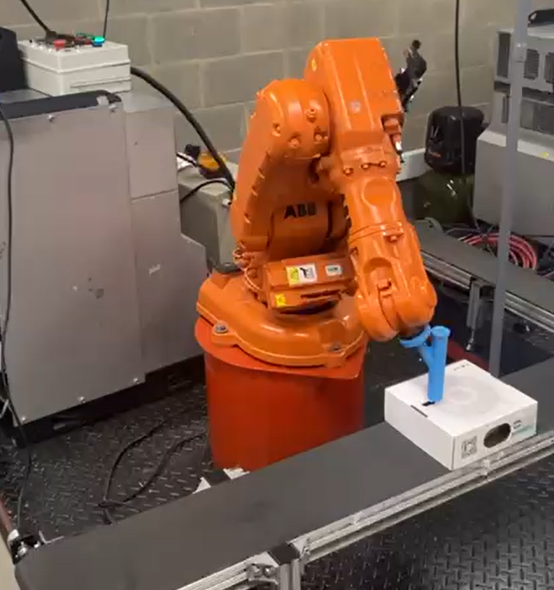
</p>

<p align="center"><b>Figura 1.</b> <em>Ubicación del robot, la banda transportadora, la estación de decoración y el pastel.</em></p>

### 🔌 Cómo se comunican las partes

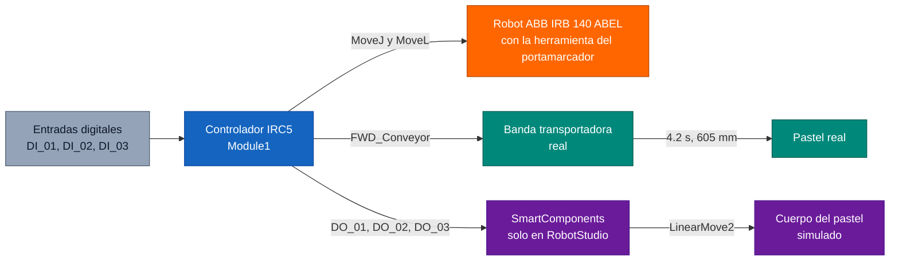

<p align="center"><b>Figura 2.</b> <em>Esquema de señales: el mismo programa mueve el robot y la banda real, y en la simulación los SmartComponents hacen el papel de la banda.</em></p>

<a id="portamarcador"></a>
## 🖊️ 2. Diseño del portamarcador

El portamarcador es la pieza que sujeta el marcador al flange del IRB 140 y define el punto donde queda el TCP del robot. Las dos rutinas usan la misma herramienta. El portamarcador seleccionado fue el número 1 ya que era mucho más simple de utilizar, menos costoso de imprimir en 3D y cumplía con todos los requerimientos para evitar singularidades. El material utilizado fue PLA de pigmentación Azul.

<table align="center">
  <tr>
    <td align="center">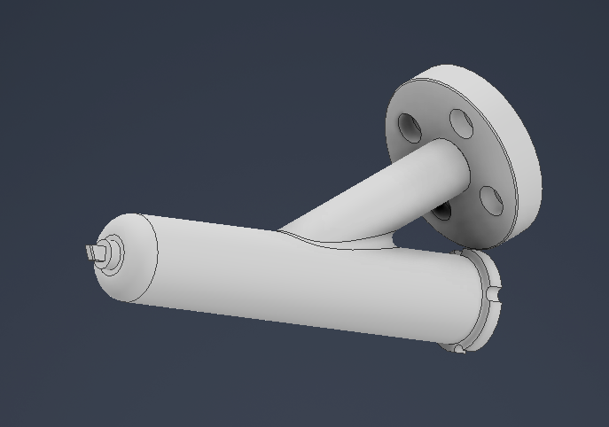</td>
    <td align="center">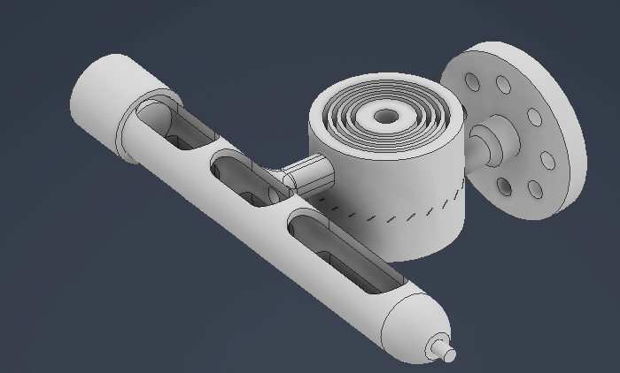</td>
  </tr>
  <tr>
    <td align="center"><b>Figura 3.</b> <em>Portamarcador, vista 1.</em></td>
    <td align="center"><b>Figura 4.</b> <em>Portamarcador, vista 2.</em></td>
  </tr>
</table>

### 🔩 Datos de la herramienta en el programa

La herramienta se llama `ToolLab1AlexaReyes` y está declarada al inicio del módulo como `PERS tooldata`:

| Parámetro | Valor |
|---|---|
| robhold | TRUE, porque la herramienta la lleva el propio robot |
| TCP respecto al flange (x, y, z) | 38.819, 1.24, 164.297 mm |
| Orientación (cuaternión) | [0.9659, 0, 0.2588, 0], que equivale a una rotación de 30° alrededor del eje Y del flange |
| Masa | 1 kg (No medido)|
| Centro de gravedad | [0, 0, 1] mm |

Este tooldata es el de la calibración virtual, hecho en RobotStudio con el modelo CAD del portamarcador. Es el que está activo en el código y el que usamos en la simulación, en las rutinas y en la implementación en el robot real. Justo debajo en el código quedó comentado el tooldata de la calibración física, que dejamos como referencia para la comparación de la sección 4.

<a id="workobject"></a>
## 📐 3. Work Object en RobotStudio

Todas las trayectorias de dibujo están programadas respecto a un Work Object y no respecto a la base del robot. Así los targets se leen como coordenadas sobre la superficie del pastel: X e Y recorren el plano del dibujo y Z = 0 es el contacto del marcador con el pastel. La Rutina 1 usa `Workobject_1` y la Rutina 2 usa `Workobject_4`.

### 🛠️ Cómo lo creamos

1. Con la caja del pastel ya ubicada en la estación, en la pestaña Inicio de RobotStudio abrimos Otros y luego Crear Work Object.
2. Le pusimos el nombre `Workobject_1` en la Rutina 1 y `Workobject_4` en la Rutina 2, y lo dejamos como fijo en el espacio (el robot no lo sostiene).
3. Para el user frame usamos la definición por tres puntos, apoyándonos en los vértices de la caja con las ayudas de ajuste (snap): primero el origen, luego un punto sobre el eje X y luego un punto sobre el eje Y.
4. En la Rutina 1 el object frame lleva un desplazamiento de 40 mm y un giro de 90° para acomodar los ejes del dibujo. En la Rutina 2 el object frame se dejó sin desplazamiento ni giro.
5. Sincronizamos con RAPID para que el `wobjdata` quedara escrito en el módulo, y con ese Work Object activo creamos todos los targets.

### 🧮 Valores que quedaron en el código

```
! Rutina 1
TASK PERS wobjdata Workobject_1:=[FALSE,TRUE,"",[[689.46,-113.7,173.2],[0,-0.707106781,0.707106781,0]],[[0,0,40],[0.707106781,0,0,0.707106781]]];

! Rutina 2
TASK PERS wobjdata Workobject_4:=[FALSE,TRUE,"",[[585.73,-135.66,60],[0.012495256,0.000156156,-0.999843844,0.012495256]],[[0,0,0],[1,0,0,0]]];
```

| Dato | 🅰️ Rutina 1 (`Workobject_1`) | 🅱️ Rutina 2 (`Workobject_4`) |
|---|---|---|
| robhold | FALSE, el Work Object está fijo en la celda | FALSE, el Work Object está fijo en la celda |
| ufprog | TRUE, el user frame está programado | TRUE, el user frame está programado |
| User frame, posición | [689.46, -113.7, 173.2] mm respecto a la base | [585.73, -135.66, 60] mm respecto a la base |
| User frame, rotación | [0, -0.7071, 0.7071, 0], un giro de 180° alrededor de un eje horizontal | [0.0125, 0.0002, -0.9998, 0.0125], un giro de casi 180° alrededor de Y con una inclinación de unos 1.4° |
| Object frame, posición | [0, 0, 40] mm sobre el eje Z del user frame | [0, 0, 0] |
| Object frame, rotación | [0.7071, 0, 0, 0.7071], un giro de 90° alrededor de Z | Sin giro |
| Z de los targets de dibujo | 0, salvo el punto de seguridad con Z = -227.23 mm | Entre -4 y +4 mm |
| Punto de seguridad | `Target_5470`, 227 mm sobre la superficie | `Target_3820`, 50 mm sobre el origen |
| `Target_Home` | Respecto a `wobj0` | Respecto a `Workobject_4`, 500 mm sobre la superficie |

En las dos rutinas los ejes del Work Object quedan así respecto a la base del robot: X apunta hacia la base del robot, Y apunta hacia el +Y de la base y Z apunta hacia abajo. Por eso los puntos con Z negativo están por encima de la superficie. En la Rutina 1 esto sale de combinar el giro del user frame con el del object frame.

En la Rutina 1 el módulo también tiene el target auxiliar `Target_WB`, que coincide en X e Y con el origen del user frame.

En la Rutina 2 los trazos se reparten alrededor del origen, con X entre -125 y 85 mm e Y entre -125 y 125 mm. Los targets no tienen Z = 0 exacto porque la variación de Z crece de forma lineal con Y, con una pendiente de 0.025 mm por cada mm, que equivale a los 1.4° de inclinación del user frame.

> [!TIP]
> La ventaja de trabajar así es que si el pastel cambia de lugar solo hay que recalcular el Work Object, sin tocar los cientos de targets del dibujo.

<a id="calibracion"></a>
## 🎯 4. Calibración con jogging en el robot ABEL

En el robot real hicimos dos calibraciones moviendo el robot a mano con el joystick del FlexPendant (jogging): la del Work Object y la de la herramienta. Primero se calibra la herramienta y después el Work Object, porque el Work Object se toca con la punta del marcador y necesita que el tooldata ya esté activo.

### 🔧 4.1 Calibración de la herramienta

1. En el FlexPendant creamos un tooldata nuevo con el nombre de la herramienta y entramos al método de definición del TCP.
2. Fijamos una punta metálica de referencia en el espacio de trabajo.
3. Con jogging lento llevamos la punta del marcador hasta tocar esa referencia desde cuatro orientaciones distintas del robot, guardando cada punto con ModPos. Esto es el método de TCP por cuatro puntos.
4. El controlador calcula la posición del TCP a partir de las cuatro poses y la guarda en el tooldata. [Completar: error medio y error máximo que mostró el FlexPendant.]

Este método solo entrega la posición del TCP, no su orientación. Por eso el tooldata real quedó con orientación [1, 0, 0, 0].

<p align="center">
  <a href="https://youtube.com/shorts/yWkMEwdqsA0">
    
  </a>
</p>

<p align="center"><b>Video.</b> <em>Simulaciones y resultados finales (2 rutinas). Enlace: </em></p>

### 📍 4.2 Calibración del Work Object

1. Con la herramienta ya activa, creamos un wobjdata nuevo y escogimos la definición del user frame por tres puntos.
2. Con jogging llevamos la punta del marcador al origen de la caja (X1), a un punto sobre su borde en dirección X (X2) y a un punto sobre su borde en dirección Y (Y1).
3. Después verificamos el resultado moviendo el robot en jogging con el sistema de coordenadas del Work Object, para confirmar que los ejes apuntan hacia donde deben.

Como el Work Object se toca con la punta del marcador, cualquier error del TCP se arrastra también al Work Object.

| Dato del user frame | 🅰️ Rutina 1, RobotStudio | 🅱️ Rutina 2, RobotStudio | 
|---|---|---|
| Posición | [689.46, -113.7, 173.2] | [585.73, -135.66, 60] |
| Rotación | [0, -0.7071, 0.7071, 0] | [0.0125, 0.0002, -0.9998, 0.0125] |

### ⚖️ 4.3 Comparación de los dos tooldata

Estos son los valores que están en el código: el de la calibración virtual (activo) y el de la calibración física (comentado). Las dos rutinas tienen las mismas dos líneas:

```
PERS tooldata ToolLab1AlexaReyes:=[TRUE,[[38.819,1.24,164.297],[0.965925826,0,0.258819045,0]],[1,[0,0,1],[1,0,0,0],0,0,0]];   ! calibración virtual
!PERS tooldata ToolLab1AlexaReyes:=[TRUE,[[37.2018,0.567088,156.366],[1,0,0,0]],[1,[0,0,0],[1,0,0,0],0,0,0]];                 ! calibración física
```

| Parámetro | 💻 RobotStudio (CAD) | 🦾 Robot real (jogging) | Diferencia |
|---|---|---|---|
| TCP x | 38.819 mm | 37.2018 mm | 1.617 mm |
| TCP y | 1.24 mm | 0.567 mm | 0.673 mm |
| TCP z | 164.297 mm | 156.366 mm | **7.931 mm** |
| Distancia entre los dos TCP | | | **cerca de 8 mm** |

> [!NOTE]
> El tooldata activo en el RAPID es el de la calibración virtual, y es el que usamos en la simulación, en las rutinas y en la implementación real. El de la calibración física quedó comentado y por eso confiamos más en el virtual.

> [!WARNING]
> Siendo sinceros, la calibración hecha en el robot real quedó bastante peor. Hay unos 8 mm de diferencia entre los dos TCP y casi todo está en Z, que es justo la dirección que más importa para que el marcador toque la superficie.

Esta es la captura de los dos marcos de herramienta vistos en RobotStudio:

<p align="center">
  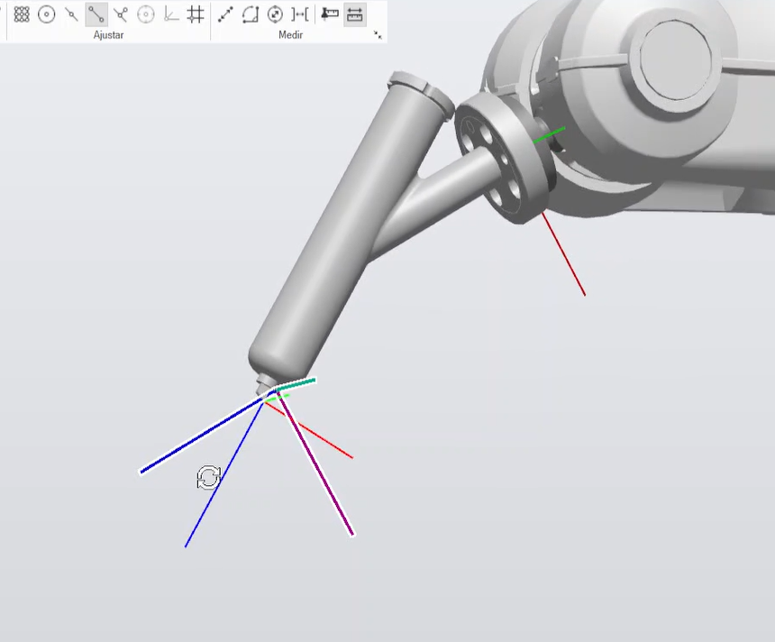
</p>

<p align="center"><b>Figura 5.</b> <em>Marco del TCP de la calibración virtual y marco del TCP de la calibración física vistos en RobotStudio.</em></p>

| Marco | Tooldata | Estado en el código |
|---|---|---|
| Marco 1 | Calibración virtual | Activo |
| Marco 2 | Calibración física | Comentado |

### 🔄 4.4 Prueba de reorientación

Una forma de comparar los dos tooldata en el robot real fue usar el movimiento de reorientación del jogging. Con un TCP bien calibrado, al reorientar la herramienta alrededor de su TCP el marco del TCP debe quedarse en la misma posición cartesiana, es decir, la punta no debería moverse mientras el resto de la herramienta gira. Con el tooldata de la calibración hecha desde el FlexPendant el punto sí se movía, y se movía mucho, así que ese TCP no coincide con la punta real. Por eso decidimos quedarnos con el tooldata virtual, que es el que está activo en el código.

### 🔍 4.5 Por qué creemos que se dieron las diferencias

1. **El TCP de RobotStudio es ideal.** Sale directamente de la geometría del modelo CAD, sin errores de impresión, de montaje en el flange ni de holgura.
2. **El jogging depende del ojo.** Para tocar la punta de referencia hay que alinear a ojo y con movimientos pequeños, y un error de un par de milímetros en cada una de las cuatro poses se acumula en el resultado.
3. **Poses poco variadas empeoran el cálculo.** Si las orientaciones de las cuatro poses se parecen entre sí, el cálculo del TCP queda mal condicionado, sobre todo en Z.
4. **El marcador real no está exactamente como en el CAD.** La pieza impresa, la forma en que el marcador asienta en su alojamiento y su propio juego mecánico mueven la punta algunos milímetros.

Como resultado, las dos rutinas usan el tooldata virtual en la simulación y en el robot real, y el de la calibración física se conserva comentado como evidencia de la comparación.

<a id="trayectorias"></a>
## ✏️ 5. Creación de las trayectorias

A partir de las curvas del dibujo de los nombres y de la decoración sacamos las trayectorias con la opción de **Trayectoria automática** (Auto Path) de RobotStudio, con estos parámetros:

| Parámetro | Valor |
|---|---|
| Tipo de aproximación | Lineal |
| Tolerancia | 0.01 mm |
| Paso (distancia mínima entre puntos) | 0.1 mm |

Elegimos aproximación lineal para que todo quedara en `MoveL` y con una tolerancia tan pequeña las curvas de las letras se siguen bien sin necesidad de `MoveC`. El precio es que los programas se vuelven largos: cada trazo es una lista de `MoveL` y los módulos tienen cientos de targets.

### 🧩 Cómo quedó repartido el dibujo en cada rutina

Las dos rutinas dibujan lo mismo en tres partes: el Nombre 1, el Nombre 2 y una decoración adicional. Esta es la comparación de cómo quedó repartido cada uno:

| Parte del dibujo | 🅰️ Rutina 1 | 🅱️ Rutina 2 |
|---|---|---|
| Decoración adicional | 317 `MoveL` en `Path_10`, una cinta de bucles continuos de unos 12 mm por 150 mm | 52 `MoveL` en `Path_1110` a `Path_1360`, un dibujo de unos 105 mm por 155 mm |
| Nombre 1 | 324 `MoveL` en `Path_20` a `Path_110` y `Path_130` a `Path_150`, de unos 84 mm de largo | 140 `MoveL`: 106 del contorno exterior en `Path_10` a `Path_260` y 34 de contornos interiores en `Path_1370` a `Path_1530`, de unos 123 mm de largo |
| Nombre 2 | 57 `MoveL` en `Path_160` a `Path_210`, de unos 45 mm de largo | 240 `MoveL`: 222 del contorno exterior en `Path_270` a `Path_1100` y 18 de contornos interiores en `Path_1540` a `Path_1620`, de unos 250 mm de largo |
| Altura de las letras | Unos 11 mm | 40 mm |
| Punto de seguridad | `Path_120` (`Target_5470`, Z = -227.23 mm), se llama después de cada trazo | `Target_3820`, 50 mm sobre el origen del Work Object |
| Total de `MoveL` de dibujo | 698, más 20 subidas al punto de seguridad | 432, más 27 subidas con `MoveJ` y 2 `MoveJ` de aproximación |

En la **Rutina 1** el programa hace 20 trazos continuos, y todos usan la misma orientación de la herramienta, así que a lo largo del dibujo solo cambian X e Y. Entre trazo y trazo el marcador sube al punto de seguridad, así nunca se arrastra tinta entre letras ni entre figuras. Todos los movimientos de dibujo van a `v300` con zona `z10`, que están dentro de los límites de la guía (entre `v100` y `v1000`, zona máxima `z10`).

En la **Rutina 2** el dibujo está dividido en muchos más procedimientos, de `Path_10` a `Path_1620`, y casi todos tienen solo dos `MoveL`. Los trazos de cada letra se dibujan primero por el contorno exterior, y los contornos interiores se dejan para el final, así el marcador se levanta entre el exterior y el interior de las letras con hueco. Cuando un trazo termina, el marcador sube con un `MoveJ` a `Target_3820`. El primer procedimiento, `Path_10`, aproxima el robot desde `Target_9`, un punto 293 mm por encima de la superficie.

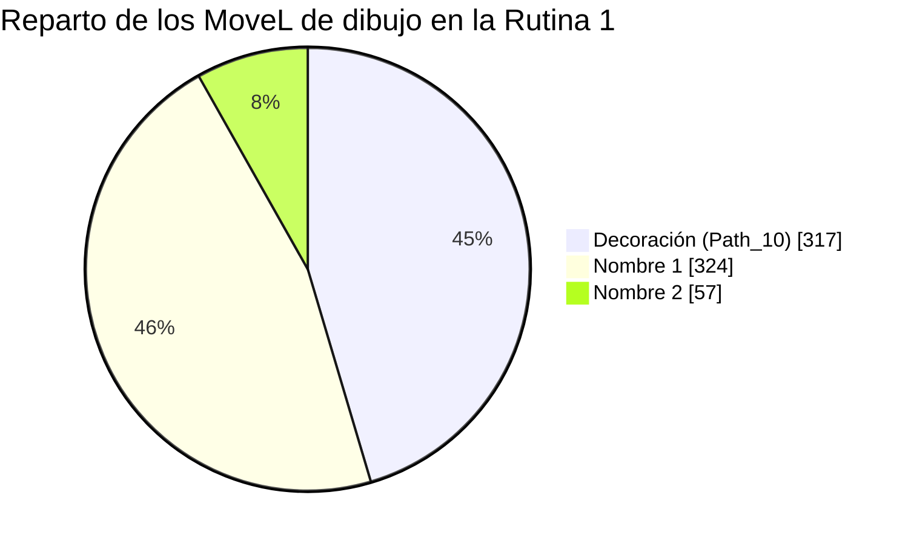

<p align="center"><b>Figura 6.</b> <em>Cantidad de movimientos MoveL por cada parte del dibujo en la Rutina 1.</em></p>

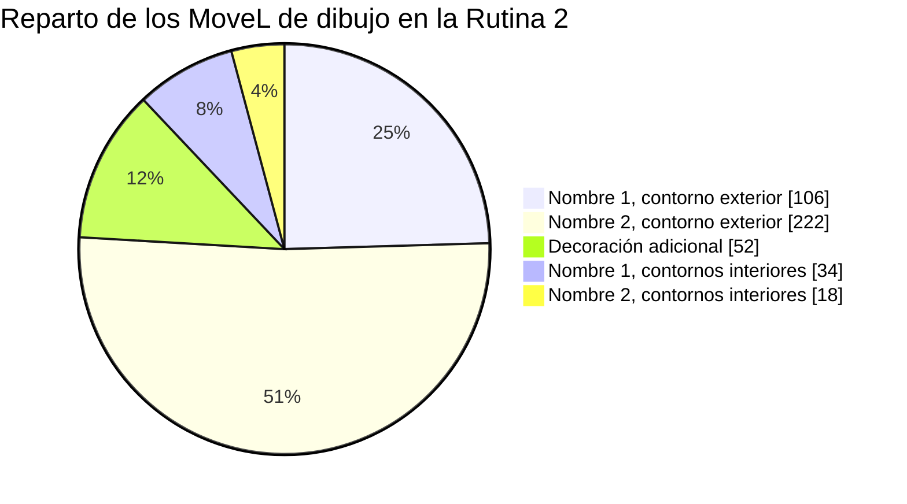

<p align="center"><b>Figura 7.</b> <em>Cantidad de movimientos MoveL por cada parte del dibujo en la Rutina 2.</em></p>

<a id="smartcomponents"></a>
## ⚙️ 6. SmartComponents y calibración de la banda

En RobotStudio el pastel es un cuerpo que no se mueve solo, así que para simular la banda creamos tres SmartComponents que lo desplazan. Cada uno usa un bloque **LinearMove2**, configurado con el cuerpo del pastel como objeto, la dirección de avance de la banda, una distancia y una duración, y su entrada `Execute` conectada en la lógica de la estación a una salida digital del controlador.

<p align="center">
  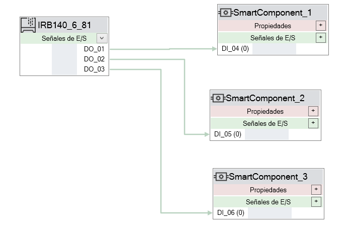
</p>

<p align="center"><b>Figura 8.</b> <em>Los tres SmartComponents y sus conexiones en la lógica de la estación.</em></p>

| SmartComponent | Función | Señal que lo dispara en la Rutina 1 | Distancia | Duración |
|---|---|---|---|---|
| 1 | Entrada: lleva el pastel hasta la estación de decoración | DO_01 | 605 mm | 4.2 s |
| 2 | Salida: saca el pastel decorado | DO_02 | 605 mm | 3 s |
| 3 | Regreso del pastel a su posición inicial para el siguiente ciclo | DO_03 | 1210 mm | [completar] |

El SmartComponent 3 recorre 1210 mm, que es la suma de los dos tramos anteriores (605 mm de entrada y 605 mm de salida). Así el pastel vuelve a su punto de partida y el ciclo se puede repetir una y otra vez, como un ciclo infinito.

### 🚚 Calibración con la banda real

Los valores del SmartComponent de entrada no los inventamos: salen de la banda real. Escribimos una rutina RAPID independiente del programa principal, que solo activaba `FWD_Conveyor` durante un tiempo y luego la detenía. La fuimos probando con distintos tiempos hasta que el pastel quedó justo en la posición de decoración. Con 4.2 s la banda lo desplazó 605 mm, es decir una velocidad de unos 144 mm/s.

Esos mismos 605 mm y 4.2 s son los que pusimos en el LinearMove2. Así la simulación y el robot real hacen lo mismo en el mismo tiempo, y el `WaitTime` del RAPID coincide con la duración del movimiento del SmartComponent. En ninguna de las dos versiones usamos sensores, la posición del pastel se controla solo con tiempos.

<a id="rapid"></a>
## 💻 7. El programa RAPID

Cada integrante tiene su propio módulo `Module1`, que se puede ver completo en el anexo. Las secciones 7.1 a 7.6 describen la Rutina 1 y la 7.7 describe la Rutina 2.

### 🧱 7.1 Estructura del módulo de la Rutina 1

1. **Herramienta.** El `tooldata` virtual (activo) y el físico (comentado).
2. **Targets.** Más de 900 `CONST robtarget`, de `Target_10` hasta `Target_9280`, más `Target_Home`, `Target_Mant` y `Target_WB`. Los de dibujo están expresados en el Work Object, tienen Z = 0, la misma orientación y la configuración [0, 0, 0, 0]. La excepción es el punto de seguridad `Target_5470`, que tiene Z = -227.23 mm y configuración [0, -1, 0, 0].
3. **Work Object.** `Workobject_1`, declarado como `TASK PERS wobjdata`.
4. **Rutinas.** `main` y los procedimientos de trayectoria `Path_xxx`.

### 🧠 7.2 La rutina main de la Rutina 1

`main` es un `WHILE TRUE DO` que en cada vuelta revisa las tres entradas con estructuras `IF` excluyentes, es decir, cada condición pide explícitamente cuál entrada debe estar en 1 y cuáles en 0. Así solo se ejecuta una rutina a la vez. Además, todas las combinaciones posibles de las tres entradas están cubiertas:

| DI_01 | DI_02 | DI_03 | Qué hace el robot |
|---|---|---|---|
| 0 | 0 | 0 | Va a HOME (`Path_Home`) y se queda esperando |
| 1 | 0 | 0 | Ciclo completo de transporte y decoración |
| 0 | 1 | 0 | Pose de mantenimiento (`Path_220`) y espera 10 s |
| 0 | 0 | 1 | Rutina Farmear Aura (`Path_230`) |
| 0 | 1 | 1 | `Path_Home` y espera 1 s |
| 1 | 1 | 0 | `Path_Home` y espera 1 s |
| 1 | 0 | 1 | `Path_Home` y espera 1 s |
| 1 | 1 | 1 | `Path_Home` y espera 1 s |

Cuando se activan dos o más entradas a la vez el robot no ejecuta ninguna rutina y se va a HOME, que es el comportamiento seguro.

### 🔄 7.3 Ciclo de decoración (DI_01) de la Rutina 1

Este es el bloque del ciclo, resumido:

```
IF DI_01 = 1 AND DI_02 = 0 AND DI_03 = 0 THEN
    Path_Home;
    Set FWD_Conveyor;
    SET DO_01;
    WaitTime 4.2;
    RESET FWD_Conveyor;
    RESET DO_01;
    Path_10;
    Path_120;
    Path_20;
    Path_120;
    ! ... lo mismo para Path_30 hasta Path_210, siempre con Path_120 después de cada trazo
    SET FWD_Conveyor;
    SET DO_02;
    WaitTime 3;
    RESET FWD_Conveyor;
    RESET DO_02;
    WaitTime 1;
    Path_Home;
    WaitTime 1;
    SET DO_03;
    WaitTime 9;
ENDIF
```

Paso a paso:

1. **Inicio en HOME.** `Path_Home` es un `MoveJ` a `Target_Home` con respecto a `wobj0`.
2. **Entrada del pastel.** Se activan `FWD_Conveyor` y `DO_01` durante 4.2 s. La banda avanza el pastel 605 mm hasta la estación y luego se apagan las dos señales, con lo que la banda queda detenida.
3. **Decoración.** Se ejecutan los 20 trazos en orden. Después de cada uno se llama a `Path_120`, que sube el marcador al punto de seguridad antes de pasar al siguiente trazo.
4. **Salida del pastel.** Con el último trazo terminado el robot queda en el punto de seguridad, se activan `FWD_Conveyor` y `DO_02` por 3 s para sacar el pastel decorado, y luego se apagan. Después hay una pausa de 1 s.
5. **Regreso a HOME.** `Path_Home` y una pausa de 1 s.
6. **Cierre del ciclo.** Se activa `DO_03` y el programa espera 9 s.

En la simulación `DO_01`, `DO_02` y `DO_03` son las salidas que disparan los tres SmartComponents de la sección 6, y los `WaitTime` de 4.2 s, 3 s y 9 s dan el tiempo para que cada movimiento termine. En el ciclo solo se usa `FWD_Conveyor`, nunca `BWD_Conveyor`, así que las dos señales de la banda jamás están activas al mismo tiempo.

> [!NOTE]
> Una cosa a tener en cuenta: como `main` vuelve a leer las entradas en cada vuelta, si DI_01 sigue en 1 cuando termina el ciclo, el programa empieza otro. Hay que bajar DI_01 al terminar.

### 🔧 7.4 Pose de mantenimiento (DI_02) de la Rutina 1

Con DI_02 en 1 se ejecuta `Path_220`, un `MoveJ` a `Target_Mant`, cuyo TCP queda en x = 0, y = -700, z = 550 mm respecto a la base. Es una pose con el brazo extendido hacia un costado, donde la herramienta queda accesible para instalarla, retirarla, revisarla o cambiar el marcador. Después el programa espera 10 s y vuelve a evaluar las entradas: mientras DI_02 siga en 1 el robot se queda en esa pose, y cuando la entrada se suelta vuelve a HOME por la rama de espera.

### 🌀 7.5 Farmear Aura (DI_03) de la Rutina 1

Con DI_03 en 1 se ejecuta `Path_230`, que recorre con `MoveJ` a `v100` los targets `Target_7000` a `Target_7040`. Los cuatro primeros puntos están sobre una circunferencia de unos 100 mm de radio, contenida en un plano inclinado a 45°, y el quinto repite el primero para cerrar el recorrido. Mientras DI_03 siga en 1 la rutina se repite, y al soltarla el robot regresa a HOME. En el módulo también quedaron definidos los targets `Target_7050` a `Target_9280`, que no se llaman desde ningún procedimiento.

### 📋 7.6 Procedimientos del módulo de la Rutina 1

| Procedimiento | Qué hace |
|---|---|
| main | Ciclo principal que lee las entradas y escoge la rutina |
| Path_Home | `MoveJ` a `Target_Home` (HOME) |
| Path_10 | Decoración adicional (317 `MoveL`) |
| Path_20 a Path_110 | Nombre 1, primera parte |
| Path_120 | Punto de seguridad sobre el pastel, se llama después de cada trazo |
| Path_130 a Path_150 | Nombre 1, segunda parte |
| Path_160 a Path_210 | Nombre 2 |
| Path_220 | Pose de mantenimiento (`MoveJ` a `Target_Mant`) |
| Path_230 | Rutina Farmear Aura (`MoveJ` a `Target_7000` a `Target_7040`) |

### 👥 7.7 La Rutina 2

La Rutina 2 tiene la misma idea, tres modos con DI_01, DI_02 y DI_03, pero está organizada distinto: la lógica de la celda está separada en procedimientos pequeños, el robot y la banda se verifican antes de moverse, y el dibujo está partido en muchos más procedimientos `Path_xxx`.

#### 🧱 Estructura del módulo

1. **Herramienta.** El mismo `tooldata` virtual activo, con el físico comentado.
2. **HOME y Work Object.** `Target_Home` y `Workobject_4`, que se explicó en la sección 3.
3. **Constantes de la lógica de la celda.**

| Constante | Valor | Para qué sirve |
|---|---|---|
| `T_ENTRADA` | 4.4 s | Tiempo desde el inicio de la banda hasta la estación de decoración, medido |
| `T_SALIDA` | 4.4 s | Tiempo desde la estación hasta el extremo final de la banda |
| `T_PARADA` | 0.5 s | Espera para que la banda quede completamente detenida |
| `TOL_HOME` | 5 mm | Tolerancia para considerar que el robot está en HOME |

4. **Pose de mantenimiento.** `jt_Mantenimiento`, un `jointtarget` con los ejes en [0, -30, 15, 0, 45, 0] grados.
5. **Targets.** De `Target_9` a `Target_4340`, todos con la misma orientación.
6. **Trayectorias.** `Path_10` a `Path_1620` y el procedimiento `Rutina_Decoracion`, que las llama en orden después de `Path_Home`.
7. **Lógica.** `main`, `Ciclo_Decoracion`, `Pose_Mantenimiento`, `Farmear_Aura`, los movimientos auxiliares y los procedimientos de la banda.

Además quedó `main1`, un procedimiento de prueba que solo recorre los trazos y no se usa en el programa.

#### 🧠 La rutina main

Primero pone la celda en un estado seguro: apaga `DO_01`, `DO_02` y `DO_03`, detiene la banda, va a HOME y escribe en el FlexPendant el menú `Celda lista: DI_01 Decorar | DI_02 Mantenimiento | DI_03 Farmear Aura`. Después entra a un `WHILE TRUE DO` que revisa las entradas con una cadena `IF ... ELSEIF`:

| Entrada | Qué ejecuta | Cómo termina |
|---|---|---|
| DI_01 | `Ciclo_Decoracion` | Espera con `WaitUntil DI_01 = 0` para no repetir el ciclo |
| DI_02 | `Pose_Mantenimiento` | Termina cuando se suelta DI_02 |
| DI_03 | `Farmear_Aura` | Espera con `WaitUntil DI_03 = 0` |

Con la cadena `ELSEIF` solo se atiende una entrada por vuelta y, si se activan varias a la vez, tiene prioridad DI_01, luego DI_02 y luego DI_03. Cada vuelta termina con un `WaitTime 0.1`. Alrededor del ciclo de decoración hay dos pares `SET FWD_Conveyor` y `RESET FWD_Conveyor` seguidos, uno antes de `Ciclo_Decoracion` y otro después de un `WaitTime 2.4`, con las líneas de `DO_01`, `DO_02` y de espera comentadas.

#### 🔄 Ciclo de decoración (DI_01)

`Ciclo_Decoracion` sigue las cuatro etapas de la guía:

1. **Inicio.** `Ir_Home`, un `MoveJ` a `Target_Home` con zona `fine` para que el robot quede detenido en HOME.
2. **Etapa 1, transporte del pastel hacia el robot.** `Banda_Atras` activa `FWD_Conveyor` y el programa espera `T_ENTRADA`, 4.4 s. Luego `Banda_Detener` apaga las dos señales y espera `T_PARADA`.
3. **Etapa 2, decoración.** `Verificar_Banda_Detenida`, luego `Set DO_01`, `Rutina_Decoracion`, y `WaitRob \InPos` para esperar a que el robot termine realmente el último movimiento antes de `Reset DO_01`. Así `DO_01` solo está activa mientras el robot dibuja.
4. **Etapa 3, retorno a HOME.** `Salir_Zona` sube el marcador 80 mm y luego `Ir_Home`.
5. **Etapa 4, transporte del pastel decorado.** `Banda_Atras`, espera de `T_SALIDA`, `Banda_Detener` y el mensaje `Ciclo terminado`.

La banda solo se mueve cuando el robot ya está en HOME, y el robot solo dibuja cuando la banda está detenida.

#### 🛡️ Enclavamientos de la banda

1. **Robot en HOME.** `Banda_Atras` y `Banda_Adelante` llaman primero a `Verificar_Robot_En_Home`, que usa la función `EnHome` para comparar la posición del TCP con `Target_Home`. Si la distancia es de 5 mm o más, detiene la banda, escribe un mensaje de error y ejecuta `Stop`.
2. **Banda detenida.** `Verificar_Banda_Detenida` revisa las dos señales antes de decorar, de ir a mantenimiento y de hacer Farmear Aura. Si alguna está activa, llama a `Banda_Detener` y espera con `WaitUntil` a que las dos estén en 0.
3. **Parada completa.** `Banda_Detener` apaga `FWD_Conveyor` y `BWD_Conveyor` y espera `T_PARADA`.
4. **Un solo sentido a la vez.** `Banda_Atras` activa `FWD_Conveyor` y `Banda_Adelante` activa `BWD_Conveyor`. Antes de activar su señal, cada uno comprueba el estado de esa misma señal y, si ya estaba activa, detiene la banda primero. Si algo falla llaman a `Falla_Banda`, que detiene la banda, escribe un mensaje y ejecuta `Stop`.

El ciclo de decoración solo usa `Banda_Atras`, que es el sentido que lleva el pastel hacia el robot en nuestra banda.

#### 🔧 Pose de mantenimiento (DI_02)

`Pose_Mantenimiento` verifica que la banda esté detenida, mueve el robot con `MoveAbsJ` a `jt_Mantenimiento` a `v100` y enciende `DO_02`. Escribe el mensaje `Robot en posicion de mantenimiento. Desactive DI_02 para salir` y se queda esperando con `WaitUntil DI_02 = 0`. Cuando se suelta DI_02 apaga `DO_02` y vuelve a HOME. Así `DO_02` indica que el robot está en la pose de mantenimiento.

#### 🌀 Farmear Aura (DI_03)

`Farmear_Aura` verifica la banda, va a HOME, arranca un reloj con `ClkStart`, enciende `DO_03` y hace tres movimientos distintos, todos alrededor de `Target_Home`:

1. **Saludo de lado a lado.** Un `FOR` repite tres veces dos `MoveJ` a v300, uno 150 mm hacia cada lado de HOME y 100 mm más abajo.
2. **Rectángulo vertical en el aire.** Cinco `MoveL` a v200 dibujan un rectángulo de 200 mm de ancho por 150 mm de alto.
3. **Asentir.** Otro `FOR` repite dos veces dos `MoveJ` con `RelTool` que giran la herramienta 20° y -20° alrededor de su punta.

Al final vuelve a HOME, apaga `DO_03`, detiene el reloj y muestra en el FlexPendant la duración medida con `ClkRead`. El comentario del código la estima en unos 15 s.

#### ⚡ Velocidades y zonas

| Movimiento | Velocidad | Zona |
|---|---|---|
| Trazos de dibujo y subidas a `Target_3820` | `v50` | `z10`, y `z1` en tres movimientos |
| `Ir_Home` y `Path_Home` | `v200` | `fine` |
| Pose de mantenimiento y `Salir_Zona` | `v100` | `fine` |
| Farmear Aura, `MoveJ` | `v300` | `z10` |
| Farmear Aura, `MoveL` | `v200` | `z10` |

#### 📋 Procedimientos del módulo

| Procedimiento | Qué hace |
|---|---|
| main | Estado seguro inicial y ciclo que atiende DI_01, DI_02 y DI_03 |
| Ciclo_Decoracion | Las cuatro etapas del ciclo automático |
| Rutina_Decoracion | Llama a `Path_Home` y a los trazos `Path_10` a `Path_1620` en orden |
| Pose_Mantenimiento | Lleva el robot a `jt_Mantenimiento` y mantiene `DO_02` |
| Farmear_Aura | Coreografía con `DO_03` y medición del tiempo |
| Ir_Home y Path_Home | `MoveJ` a `Target_Home` |
| Salir_Zona | Sube 80 mm desde la posición actual con un `MoveL` |
| EnHome | Función que devuelve TRUE si el TCP está a menos de 5 mm de HOME |
| Banda_Atras y Banda_Adelante | Activan `FWD_Conveyor` y `BWD_Conveyor` con verificaciones |
| Banda_Detener | Apaga las dos señales y espera `T_PARADA` |
| Verificar_Banda_Detenida y Verificar_Robot_En_Home | Verificaciones previas |
| Falla_Banda | Detiene la banda y el programa ante un fallo de enclavamiento |
| Path_10 a Path_1620 | Trazos del dibujo |

<a id="diagramas"></a>
## 🔀 8. Diagramas de flujo

Los diagramas siguen el `main` de cada rutina y están hechos con Mermaid, así que GitHub los dibuja directamente desde el README. Los diagramas 8.1 a 8.5 corresponden a la Rutina 1 y los 8.6 y 8.7 a la Rutina 2. Los colores indican a qué parte del programa pertenece cada bloque:

| Color | Significado |
|---|---|
| 🔵 Azul | Lógica común del programa |
| 🔷 Azul oscuro | Ciclo de decoración |
| 🟠 Naranja | Mantenimiento |
| 🟢 Verde | Farmear Aura |
| ⚪ Gris | Inicio y bucle infinito |

Los rombos son decisiones, los paralelogramos son entradas o salidas digitales y los óvalos son inicio o fin.

### 🌐 8.1 Rutina 1: visión general del sistema

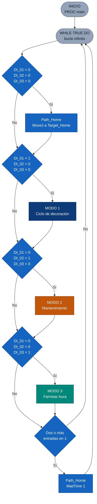

<p align="center"><b>Figura 9.</b> <em>Diagrama de flujo general del sistema, Rutina 1.</em></p>

Muestra la lógica de `main`. El programa arranca, se queda en un bucle infinito y en cada vuelta evalúa las entradas en orden. Si las tres están en 0, el robot va a HOME. Si solo DI_01 está activa, entra al modo 1; si solo DI_02, al modo 2; y si solo DI_03, al modo 3. Cualquier otra combinación manda al robot a HOME. Al terminar cada modo se vuelve al inicio del bucle.

### 🟦 8.2 Rutina 1, modo 1: ciclo de decoración

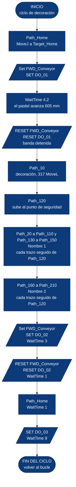

<p align="center"><b>Figura 10.</b> <em>Diagrama de flujo del ciclo de decoración, Rutina 1.</em></p>

Sigue el orden de la sección 7.3: HOME, entrada del pastel con `FWD_Conveyor` y `DO_01` durante 4.2 s, los 20 trazos con el punto de seguridad después de cada uno, salida del pastel con `FWD_Conveyor` y `DO_02` durante 3 s, regreso a HOME y cierre del ciclo con `DO_03`.

### 🟧 8.3 Rutina 1, modo 2: mantenimiento

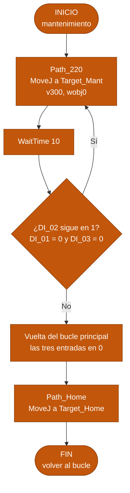

<p align="center"><b>Figura 11.</b> <em>Diagrama de flujo de la pose de mantenimiento, Rutina 1.</em></p>

El robot se mueve con `MoveJ` a la pose de mantenimiento, espera 10 s y revisa si DI_02 sigue activa. Si sigue en 1 se queda en la pose, y si se soltó el bucle principal lo devuelve a HOME.

### 🟩 8.4 Rutina 1, modo 3: Farmear Aura

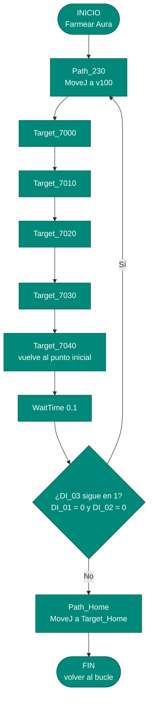

<p align="center"><b>Figura 12.</b> <em>Diagrama de flujo de la rutina Farmear Aura, Rutina 1.</em></p>

El robot recorre con `MoveJ` los cinco puntos de la trayectoria cerrada. Si DI_03 sigue activa el recorrido se repite, y cuando se suelta el robot vuelve a HOME por el bucle principal.

### ⏱️ 8.5 Rutina 1: secuencia temporal del ciclo DI_01

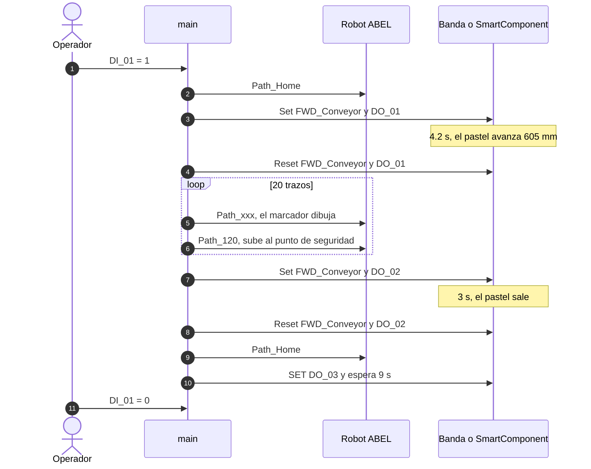

<p align="center"><b>Figura 13.</b> <em>Quién hace qué y en qué orden durante un ciclo completo, Rutina 1.</em></p>

### 🌐 8.6 Rutina 2: rutina main

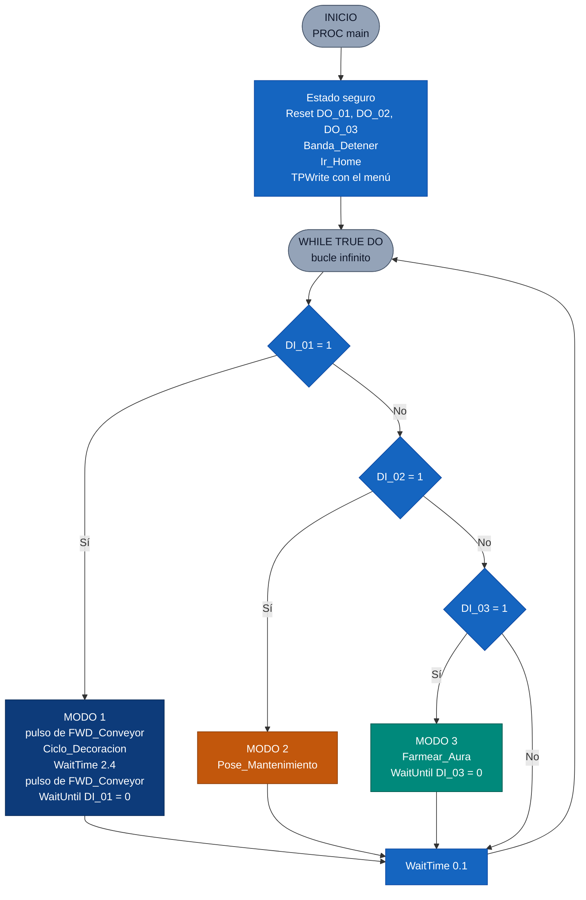

<p align="center"><b>Figura 14.</b> <em>Diagrama de flujo de la rutina main, Rutina 2.</em></p>

A diferencia de la Rutina 1, este `main` empieza poniendo la celda en un estado seguro y atiende las entradas con una cadena `IF ... ELSEIF`, así que solo ejecuta un modo por vuelta y le da prioridad a DI_01, luego a DI_02 y luego a DI_03. Los modos 1 y 3 esperan a que se suelte su entrada para no repetirse, y el modo 2 espera dentro de `Pose_Mantenimiento`.

### 🟦 8.7 Rutina 2: ciclo de decoración

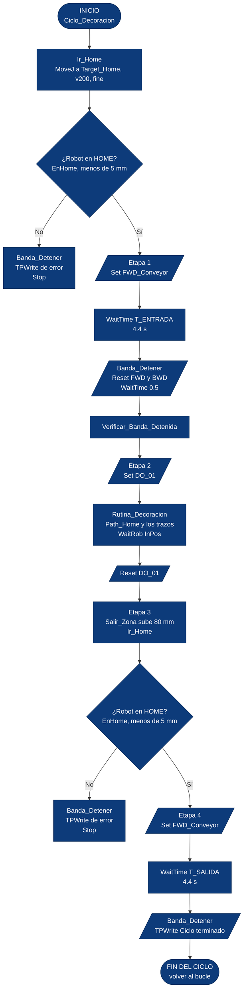

<p align="center"><b>Figura 15.</b> <em>Diagrama de flujo del ciclo de decoración con las verificaciones de la banda, Rutina 2.</em></p>

Sigue las cuatro etapas de la guía. Cada vez que se va a mover la banda se comprueba que el robot esté en HOME, y si no lo está el programa detiene la banda, escribe un error y se detiene con `Stop`. `DO_01` solo está activa durante la decoración, y el robot sube, vuelve a HOME y solo entonces se mueve la banda para sacar el pastel.

<a id="instrucciones"></a>
## 📚 9. Instrucciones y funciones de RAPID utilizadas

| Elemento | Para qué lo usamos | Línea del programa |
|---|---|---|
| `MODULE` y `ENDMODULE` | Agrupar datos y rutinas en un solo módulo | `MODULE Module1` |
| `PROC` y `ENDPROC` | Separar el programa en procedimientos reutilizables | `PROC Path_Home()` |
| `PERS tooldata` | Definir la herramienta y su TCP | `PERS tooldata ToolLab1AlexaReyes:=[TRUE,[[38.819,1.24,164.297],...` |
| `TASK PERS wobjdata` | Definir el Work Object del pastel | `TASK PERS wobjdata Workobject_1:=[FALSE,TRUE,"",...` |
| `CONST robtarget` | Guardar la posición, orientación y configuración de cada punto | `CONST robtarget Target_20:=[[115.336,30.849,0],...` |
| `MoveJ` | HOME, pose de mantenimiento y Farmear Aura, movimientos articulares donde no importa que la punta siga una recta | `MoveJ Target_Home,v300,z10,ToolLab1AlexaReyes\WObj:=wobj0;` |
| `MoveL` | Todos los trazos y la subida al punto de seguridad | `MoveL Target_20,v300,z10,ToolLab1AlexaReyes\WObj:=Workobject_1;` |
| `speeddata` | Velocidad `v300` en el dibujo, HOME y mantenimiento, y `v100` en Farmear Aura | `v300`, `v100` |
| `zonedata` | Zona de aproximación `z10` en todos los movimientos | `z10` |
| `\WObj` | Indicar en cuál sistema de coordenadas se interpreta cada target | `\WObj:=Workobject_1` |
| `WHILE TRUE DO` | Ciclo infinito de `main` | `WHILE TRUE DO` |
| `IF ... THEN ... ENDIF` con `AND` | Selección excluyente de cada modo según las tres entradas | `IF DI_01 = 1 AND DI_02 = 0 AND DI_03 = 0 THEN` |
| `Set` y `Reset` | Activar y desactivar `FWD_Conveyor` y las salidas `DO_01` a `DO_03` | `Set FWD_Conveyor;` y `RESET DO_01;` |
| `WaitTime` | Tiempos de la banda (4.2 s y 3 s), pausas y espera en mantenimiento | `WaitTime 4.2;` |
| Lectura de `DI_01` a `DI_03` | Se leen directamente dentro de las condiciones, no hace falta una instrucción aparte | `IF DI_02 = 1 ...` |

La tabla anterior corresponde a la Rutina 1. No usamos `MoveC` porque con la aproximación lineal de la trayectoria automática las curvas ya quedan cubiertas con `MoveL`.

### ➕ Instrucciones adicionales de la Rutina 2

| Elemento | Para qué lo usamos | Línea del programa |
|---|---|---|
| `CONST num` | Guardar los tiempos y la tolerancia de la celda en un solo lugar | `CONST num T_ENTRADA := 4.4;` |
| `CONST jointtarget` y `MoveAbsJ` | Ir a la pose de mantenimiento definida con los ángulos de los ejes | `MoveAbsJ jt_Mantenimiento, v100, fine, ...` |
| `IF ... ELSEIF ... ENDIF` | Atender una sola entrada por vuelta con prioridad | `ELSEIF DI_02 = 1 THEN` |
| `WaitUntil` | Esperar a que se suelte una entrada o a que la banda esté detenida | `WaitUntil DI_01 = 0;` |
| `WaitRob \InPos` | Esperar a que el robot termine realmente el último movimiento | `WaitRob \InPos;` |
| `FOR ... ENDFOR` | Repetir los movimientos de Farmear Aura | `FOR i FROM 1 TO 3 DO` |
| `Offs` | Desplazar un target respecto a otro | `Offs(Target_Home, 0, 150, 100)` |
| `RelTool` | Girar la herramienta alrededor de su punta | `RelTool(Target_Home, 0, 0, 0 \Ry:=20)` |
| `CRobT` y `Distance` | Leer la posición actual y medir la distancia a HOME | `Distance(p.trans, Target_Home.trans) < TOL_HOME` |
| `FUNC`, `RETURN` y `VAR` | Función `EnHome` que devuelve TRUE o FALSE | `FUNC bool EnHome()` |
| `DOutput` | Leer el estado de las señales de la banda | `IF DOutput(FWD_Conveyor) = 1 THEN` |
| `AND`, `OR` y `NOT` | Combinar condiciones de las verificaciones | `IF NOT EnHome() THEN` |
| `Stop` | Detener el programa si falla un enclavamiento | `Stop;` |
| `TPWrite` | Mostrar mensajes y estados en el FlexPendant | `TPWrite "Etapa 1: transportando el pastel hacia el robot";` |
| `VAR clock`, `ClkReset`, `ClkStart`, `ClkStop` y `ClkRead` | Medir cuánto dura Farmear Aura | `TPWrite "Duracion de Farmear Aura (s): " \Num:=ClkRead(reloj);` |

<a id="resultados"></a>
## 🎥 10. Resultados

### 📹 Video

El video muestra las simulaciones en RobotStudio y los resultados finales en el robot real de las dos rutinas.

<p align="center">
  <a href="https://www.youtube.com/watch?v=ID_VIDEO">
    
  </a>
</p>

<p align="center"><b>Video.</b> <em>Simulaciones y resultados finales (2 rutinas). Enlace: </em></p>

### 🍰 Pastel final

<table align="center">
  <tr>
    <td align="center"><b>🅰️ Rutina 1</b></td>
    <td align="center"><b>🅱️ Rutina 2</b></td>
  </tr>
  <tr>
    <td align="center">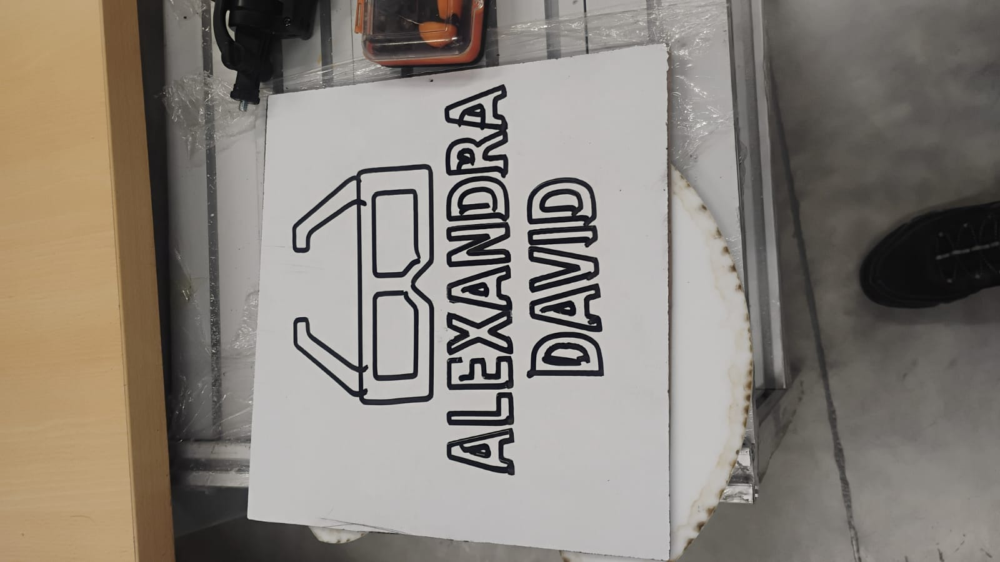</td>
    <td align="center">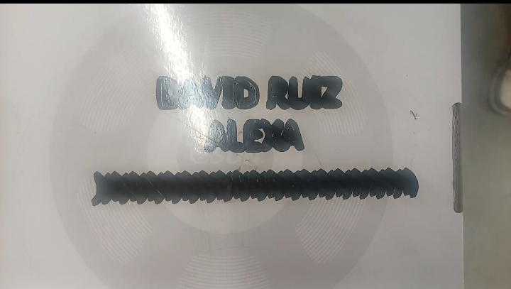</td>
  </tr>
  <tr>
    <td align="center"><b>Figura 16.</b> <em>Pastel decorado con la Rutina 1.</em></td>
    <td align="center"><b>Figura 17.</b> <em>Pastel decorado con la Rutina 2.</em></td>
  </tr>
</table>

<a id="ejecucion"></a>
## 🛡️ 11. Cómo ejecutarlo y seguridad

### ▶️ Pasos para correr el programa

1. Cargar el `Module1` de la rutina que se quiere probar en RobotStudio o en el controlador del robot.
2. Comprobar que la línea activa del `tooldata` es la de la calibración virtual, sin comentar. Es la que usamos en la simulación, en las rutinas y en el robot real.
3. Poner el pastel al inicio de la banda y dejar el robot en HOME.
4. Activar solo DI_01 para el ciclo de decoración y soltarla cuando termine.
5. Activar solo DI_02 para ir a la pose de mantenimiento, o solo DI_03 para la rutina Farmear Aura.

Si se activan varias entradas a la vez, la Rutina 1 manda el robot a HOME y la Rutina 2 atiende primero DI_01, luego DI_02 y luego DI_03.

### ⚠️ Consideraciones de seguridad

1. Verificar siempre las trayectorias en RobotStudio antes de ejecutarlas en el robot real, y comprobar que todos los puntos sean alcanzables y que no haya colisiones con la banda, las mesas o la herramienta.
2. Hacer las primeras pruebas con velocidades reducidas y tener a mano el paro de emergencia.
3. En la Rutina 1 la banda se detiene antes de que el robot dibuje, y antes de sacar el pastel el robot sube a 227 mm sobre la superficie, que es el punto de seguridad. En la Rutina 2 el robot sube 80 mm, vuelve a HOME y solo entonces se mueve la banda, y si no está en HOME el programa se detiene con un mensaje de error.
4. Ninguno de los dos ciclos activa `FWD_Conveyor` y `BWD_Conveyor` al mismo tiempo: la Rutina 1 solo usa `FWD_Conveyor`, y la Rutina 2 usa los procedimientos `Banda_Atras`, `Banda_Adelante` y `Banda_Detener` con sus verificaciones. Antes de cambiar el sentido de la banda hay que detenerla.
5. Seguir siempre las indicaciones del docente responsable del laboratorio.

