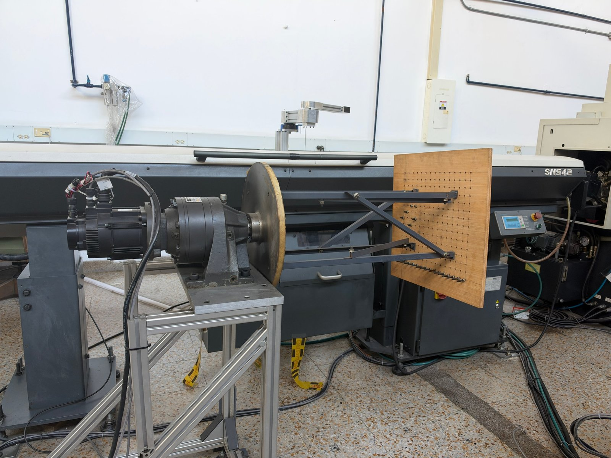
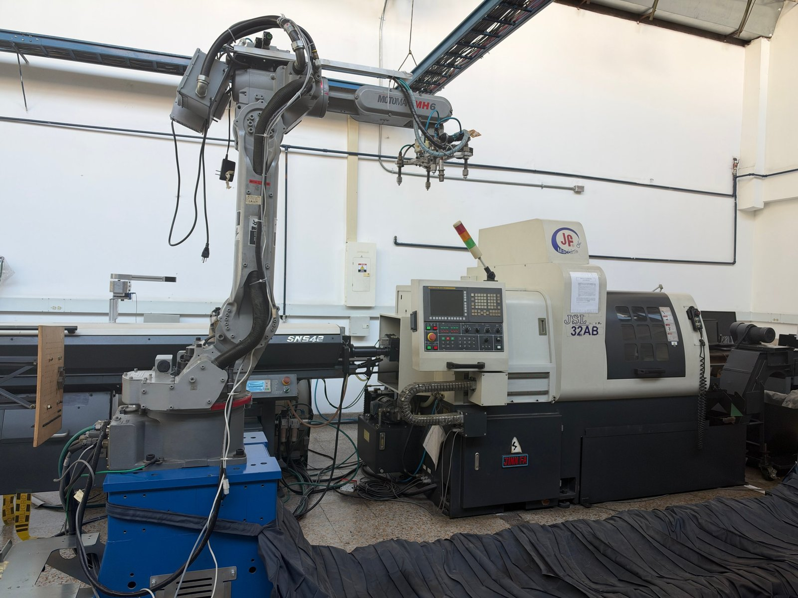
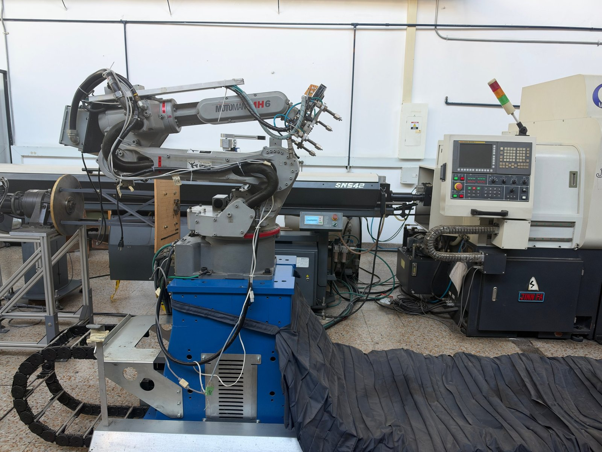
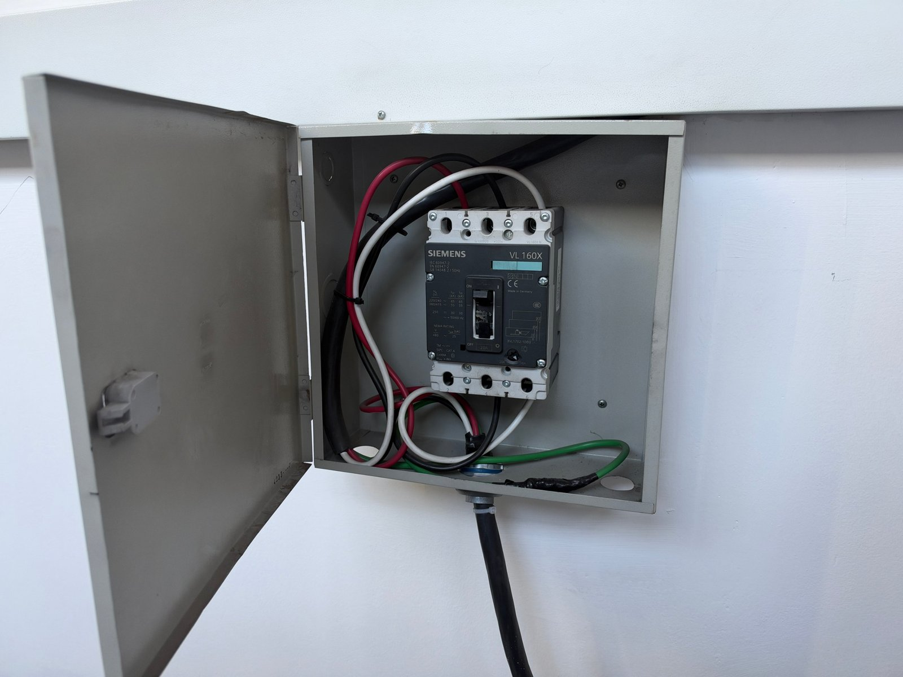
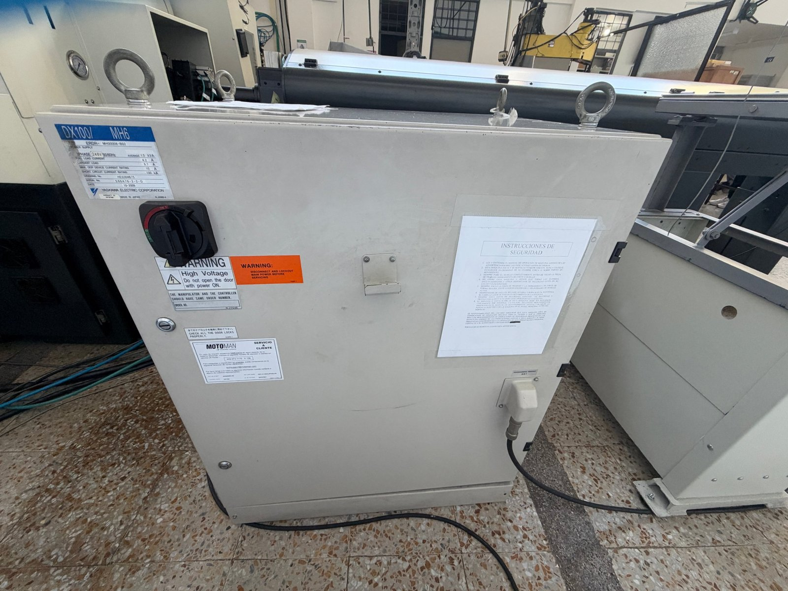
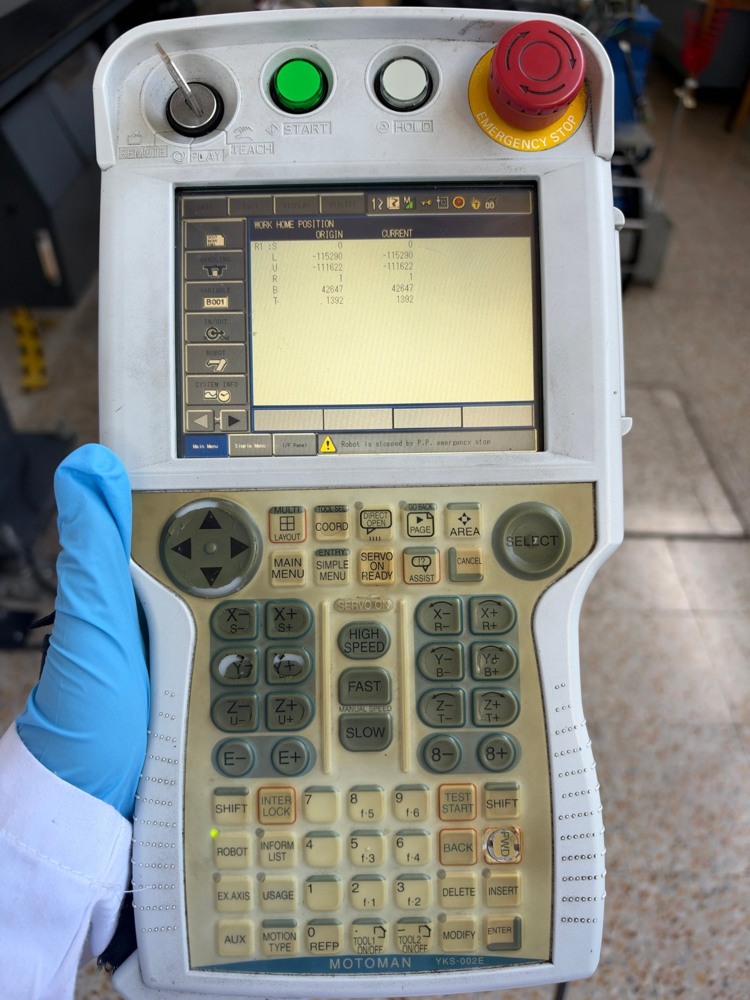
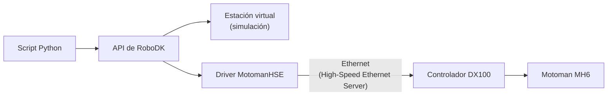
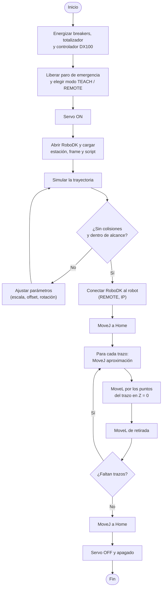

# Laboratorio No. 02: Análisis y operación del manipulador Motoman MH6

Robótica Industrial · 2026-I

**Integrantes**

- Marbel Alexandra Garavito Cordero
- David Felipe Ruiz Reyes

En esta práctica se opera el manipulador **Yaskawa Motoman MH6** (controlador **DX100**): se compara con el ABB IRB140, se describen sus posiciones Home, se mueve en modo manual desde el teach pendant, se controla desde el PC con **RoboDK** y se ejecuta una **trayectoria polar** primero en simulación y luego sobre el robot real.

## Contenido

1. [La celda de trabajo y plano de planta](#1-la-celda-de-trabajo-y-plano-de-planta)
2. [Cuadro comparativo: MH6 vs IRB140](#2-cuadro-comparativo-mh6-vs-irb140)
3. [Posiciones Home 1 y Home 2](#3-posiciones-home-1-y-home-2)
4. [Puesta en marcha y movimientos manuales](#4-puesta-en-marcha-y-movimientos-manuales)
5. [Niveles de velocidad manual](#5-niveles-de-velocidad-manual)
6. [RoboDK: funciones y comunicación con el Motoman](#6-robodk-funciones-y-comunicación-con-el-motoman)
7. [RoboDK vs RobotStudio](#7-robodk-vs-robotstudio)
8. [Trayectoria polar](#8-trayectoria-polar)
9. [Recursos y referencias](#9-recursos-y-referencias)
10. [Video](#10-video)

---

## 1. La celda de trabajo y plano de planta

| N.º | Elemento | Función en la práctica |
|---|---|---|
| 1 | Totalizador (Siemens VL160X, 20 A) | Alimentación general de la celda |
| 2 | Alimentador de barra SNS42 | Equipo vecino; define el entorno de trabajo |
| 3 | Torno CNC JSL 32AB | Equipo vecino; zona a evitar al mover el robot |
| 4 | Eje externo (7.º GDL) | Se opera con las teclas E± del pendant |
| 5 | Motoman MH6 | Manipulador de 6 ejes (S, L, U, R, B, T) |
| 6 | Plano de dibujo | Frame `Frame_from_Target1` de RoboDK donde se traza |
| 7 | Controlador DX100 | Gobierna el robot; recibe órdenes del pendant y del PC |
| 8 | Teach pendant | Operación manual y selección de modo |
| 9 | PC con RoboDK | Simulación y ejecución remota por Ethernet |

**Eje externo (7.º grado de libertad):**

---

## 2. Cuadro comparativo: MH6 vs IRB140

Ambos son robots articulados de 6 ejes con la misma carga útil (6 kg). El MH6 gana en alcance; el IRB140 es más compacto, liviano y repetible.

**Datos generales**

| | Motoman MH6 | ABB IRB140 |
|---|---|---|
| Fabricante / controlador | Yaskawa / DX100 | ABB / IRC5 |
| Carga máxima | 6 kg | 6 kg |
| Alcance | 1422 mm | 810 mm |
| Repetibilidad | ±0,08 mm | ±0,03 mm |
| Peso del manipulador | 130 kg | 98 kg |
| Montaje | Suelo, pared, techo | Suelo, pared, techo |
| Temperatura de operación | 0 a 45 °C | 5 a 45 °C |
| Aplicaciones típicas | Manipulación, alimentación de máquinas, ensamble, soldadura, dispensado, empaque | Manejo de materiales, ensamble, fundición, cuarto limpio, soldadura, pegado |

**Rango y velocidad por eje** (el eje 1 a 6 del IRB140 corresponde a S, L, U, R, B, T del MH6)

| Eje | Rango MH6 | Rango IRB140 | Vel. máx. MH6 | Vel. máx. IRB140 |
|---|---|---|---|---|
| 1 (S) | ±170° | ±180° | 220 °/s | 200 °/s |
| 2 (L) | +155° / −90° | +110° / −90° | 200 °/s | 200 °/s |
| 3 (U) | +250° / −175° | +50° / −230° | 220 °/s | 260 °/s |
| 4 (R) | ±180° | ±200° | 410 °/s | 360 °/s |
| 5 (B) | +225° / −45° | ±115° | 410 °/s | 360 °/s |
| 6 (T) | ±360° | ±400° | 610 °/s | 450 °/s |

**Lectura:** el MH6 cubre un volumen de trabajo mucho mayor (por eso puede atender la máquina y el eje externo desde una sola base) y gira más rápido en la muñeca (R, B, T). El IRB140 es preferible cuando se prioriza la precisión de posicionamiento y el espacio es reducido.

---

## 3. Posiciones Home 1 y Home 2

El DX100 guarda dos posiciones de referencia: la **Work Home Position** (Home 1) y la **Second Home Position** (Home 2). En esta celda se usan así:

| | Home 1 (trabajo) | Home 2 (transporte) |
|---|---|---|
| Pose | Brazo inferior (L) vertical, brazo superior (U) horizontal, herramienta hacia abajo | Pose plegada: L inclinado y U recogido sobre él; el robot queda compacto |
| Uso | Inicio y fin de cada rutina; punto de partida de los trayectos | Traslado, almacenamiento o intervención con el robot recogido |

**Posición de cada articulación en Home 1.** El pendant (menú `ROBOT`, pantalla *WORK HOME POSITION*) muestra los pulsos de encoder de cada eje. Origen y valor actual coinciden, es decir, el robot estaba en esa posición al tomar la foto:

| Eje | S | L | U | R | B | T |
|---|---|---|---|---|---|---|
| Pulsos (origen = actual) | 0 | −115 290 | −111 622 | 1 | 42 647 | 1 392 |

**Posición de cada articulación en Home 2.** _Pendiente: registrar los pulsos desde `ROBOT ▸ SECOND HOME POSITION` en el pendant y completar esta fila._

| Eje | S | L | U | R | B | T |
|---|---|---|---|---|---|---|
| Pulsos (Home 2) | _por registrar_ | _por registrar_ | _por registrar_ | _por registrar_ | _por registrar_ | _por registrar_ |

**¿Cuál es mejor?** Depende de la tarea, pero para operar es mejor **Home 1**: es una pose abierta y de referencia desde la que el brazo llega con rapidez a la zona de trabajo, y es el tipo de pose que se usa como punto de partida y de retorno en el script (target `TargetHome`). **Home 2** no sirve para trabajar porque el robot queda recogido y lejos de la zona útil; su ventaja es la compacidad, que lo hace más seguro y estable para moverlo o guardarlo. Por eso se parte y se termina en Home 1, y se reserva Home 2 para transporte.

---

## 4. Puesta en marcha y movimientos manuales

### 4.1 Energizado y habilitación

1. Despejar el área de trabajo y comprobar que el paro de emergencia esté al alcance.
2. Subir los breakers del tablero rotulados **MOTOMAN** y el **totalizador** de la celda.

   

3. Girar a **ON** la perilla de la puerta del **DX100**. La puerta no se abre con el equipo energizado.

   

   La placa del controlador indica alimentación trifásica de 240 V, 1,5 kVA promedio y protección máxima de 15 A.

4. Desenrollar el cable del pendant sin pisarlo y tomarlo con el cable por detrás del cuello.
5. Liberar el **paro de emergencia** del pendant girando el hongo en sentido horario.
6. Con la llave del selector elegir **TEACH** para mover a mano o **REMOTE** para que el PC controle el robot.
7. En el menú principal entrar a `ROBOT`, pulsar **SERVO ON READY** y sujetar el interruptor de habilitación (hombre muerto) para encender los servos.

*En la foto aparece el aviso "Robot is stopped by P.P. emergency stop": el paro del pendant estaba activado y debe liberarse antes del paso 7.*

### 4.2 Cambio de modo de movimiento

La tecla **COORD** cambia el sistema de coordenadas con el que responden las teclas de eje. Cada pulsación avanza en este orden: **Joint → Cartesiano/cilíndrico → Tool → User**. El modo activo se ve en el área de estado de la parte superior de la pantalla. `SHIFT + COORD` cambia el número de herramienta o de usuario cuando se está en Tool o User.

Con `ROBOT` o `EX.AXIS` se elige qué grupo se mueve: el manipulador o los ejes externos.

### 4.3 Teclas de eje

Las teclas de eje se mantienen pulsadas mientras se sujeta el interruptor de habilitación. Se pueden pulsar varias a la vez para mover varios ejes.

| Modo | Teclas del bloque izquierdo | Teclas del bloque derecho |
|---|---|---|
| **Joint** (articular) | `S−/S+`, `L−/L+`, `U−/U+` | `R−/R+`, `B−/B+`, `T−/T+` |
| **Cartesiano** | Traslación: `X−/X+`, `Y−/Y+`, `Z−/Z+` | Rotación: `Rx`, `Ry`, `Rz` (giro alrededor de X, Y, Z) |
| **Tool / User** | Igual que cartesiano, pero sobre los ejes de la herramienta o del sistema de usuario | Igual |
| **Ejes externos** | `E−/E+` y `8−/8+` | |

Cada tecla tiene dos funciones impresas (por ejemplo `X− / S−`): la que vale depende del modo.

### 4.4 Secuencia recomendada

1. Mover en **Joint** hasta una postura segura y alejada de los equipos vecinos.
2. Pasar a **Cartesiano** con `COORD` y aproximarse primero en **Z**, luego corregir X e Y, y por último ajustar la orientación con las rotaciones.
3. Si el robot se acerca a una singularidad (por ejemplo, la muñeca con B cerca de 0°) o a un límite, volver a Joint, reorientar y regresar a Cartesiano.
4. Para detalles finos, bajar la velocidad (sección siguiente).

---

## 5. Niveles de velocidad manual

El pendant tiene **cuatro niveles** de velocidad manual:

| Nivel | Nombre en el manual | Uso típico |
|---|---|---|
| Inching | `INCH` | Un paso muy pequeño por pulsación, para ajuste fino |
| Lento | `SLW` | Cerca de piezas o de equipos |
| Medio | `MED` | Desplazamientos generales |
| Rápido | `FST` | Movimientos en el aire, con buena visibilidad |

**Cómo cambiar de nivel** (teclas del grupo *MANUAL SPEED*):

- **FAST** sube un nivel: INCH → SLW → MED → FST.
- **SLOW** baja un nivel: FST → MED → SLW → INCH.
- **HIGH SPEED** mantenida junto con una tecla de eje mueve el robot a una velocidad alta preconfigurada, sin cambiar el nivel seleccionado. No funciona en `INCH`.

**Cómo identificarlo en la pantalla:** el nivel activo aparece como un ícono en el área de estado de la parte superior, junto a los íconos del grupo de control, del sistema de coordenadas y del modo de seguridad. El nivel elegido también se aplica a los movimientos con `FWD` y `BWD` al probar un trabajo.

Buena práctica: empezar en lento o medio al acercarse a la superficie de trabajo y subir solo con el camino libre.

---

## 6. RoboDK: funciones y comunicación con el Motoman

### 6.1 Qué hace RoboDK

- **Simulación 3D** de la celda: robot, herramientas, marcos de referencia y colisiones.
- **Programación offline:** se define la trayectoria en el PC y se prueba antes de llevarla al robot.
- **Cinemática:** calcula la cinemática inversa y verifica alcance, límites articulares y singularidades.
- **API en Python** (y otros lenguajes) para generar trayectorias por código, como en esta práctica.
- **Postprocesadores:** convierten el programa a código nativo del controlador; para Motoman genera archivos de trabajo **.JBI**.
- **Driver online:** ejecuta en el robot real lo que se simula.

### 6.2 Cómo mueve RoboDK al manipulador

Cada `MoveJ` o `MoveL` del script se resuelve en la estación: RoboDK calcula las posiciones articulares de cada punto, comprueba que sean alcanzables y las envía al controlador mediante el driver, que ordena el movimiento al DX100. Si no hay conexión, el mismo script solo mueve el modelo virtual.

### 6.3 Cómo se comunica

1. En RoboDK, `Connect ▸ Connect to Robot`, se escribe la **IP** del controlador y se conecta. El driver usado es **MotomanHSE**.
2. El controlador debe estar en **REMOTE** (selector del pendant) y con los servos listos.
3. Desde Python, `robot.Connect()` reutiliza esa conexión y las instrucciones del script se ejecutan en el robot.

También se puede trabajar **sin conexión en vivo**: se genera el programa `.JBI` desde RoboDK, se transfiere al DX100 por USB o FTP y se ejecuta desde el pendant.

---

## 7. RoboDK vs RobotStudio

| | RoboDK | RobotStudio (ABB) |
|---|---|---|
| Marcas | Multimarca (Motoman, ABB, KUKA, Fanuc, UR y otras) | Solo robots ABB |
| Simulación | Motor cinemático propio; buena para trayectorias, alcance y colisiones | Controlador virtual con el firmware real (RobotWare), casi idéntico al robot físico |
| Lenguaje | Python, C#, C++, Matlab; el código se genera con postprocesadores | RAPID, nativo de ABB |
| Ventajas | Flexible, rápido de aprender, fácil de automatizar con scripts | Máxima fidelidad: tiempos de ciclo, E/S, zonas de blend, MultiMove |
| Limitaciones | La lógica fina del controlador depende del postprocesador y del driver | Limitado al ecosistema ABB; las funciones avanzadas requieren licencia |
| Aplicaciones | Laboratorios, integradores con varias marcas, trayectorias por CAD o por código | Puesta en marcha virtual de celdas ABB, depuración de RAPID, validación de tiempos |

**Qué significa para nosotros cada herramienta**

- **RoboDK** es la herramienta con la que programamos y movemos el Motoman desde el PC: nos permite probar en simulación y pasar al robot real con el mismo script.
- **RobotStudio** es el gemelo digital del mundo ABB: tiene sentido cuando la celda es ABB y se necesita validar el programa con el controlador virtual antes de tocar el hardware.

---

## 8. Trayectoria polar

### Integrantes

- Marbel Alexandra Garavito Cordero
- David Felipe Ruiz Reyes

### Qué se dibuja

El robot traza una **mariposa**, una curva en coordenadas polares, y debajo de ella los nombres de los integrantes (*Felipe* y *Alexandra*) como contornos de texto. La curva es

$$r(\theta) = e^{\sin\theta} - 2\cos(4\theta) + \sin^5\!\left(\frac{2\theta - \pi}{24}\right), \qquad \theta \in [0,\, 12\pi]$$

que se pasa a coordenadas cartesianas con `x = r·cosθ`, `y = r·sinθ` y se escala para que el radio máximo sea de 150 mm.

### Cómo funciona el código

El script completo está en [`anexos/trayectoria_polar.py`](anexos/trayectoria_polar.py). Requiere RoboDK abierto y los paquetes `robodk`, `numpy` y `matplotlib`.

| Parte | Qué hace |
|---|---|
| Conexión | Elige el robot, carga `Frame_from_Target1` y el target `TargetHome`, y fija velocidad (300 mm/s) y redondeo (0,1 mm) |
| `butterfly()` | Genera los puntos de la curva polar y los simplifica |
| `text_paths()` | Convierte cada nombre en contornos con `TextPath` y los escala a una caja de 240 × 38 mm |
| `rdp()` | Algoritmo Ramer-Douglas-Peucker: elimina puntos redundantes con una tolerancia de 0,3 mm, para reducir movimientos |
| `transform()` | Aplica espejo en Y, rotación de 90° y desplazamiento para orientar el dibujo sobre la superficie |
| `draw()` | Para cada trazo: `MoveJ` de aproximación, `MoveL` por todos los puntos a Z = 0 y `MoveL` de retirada |
| Rutina | `MoveJ` a Home, dibuja la mariposa y los nombres, y vuelve a Home |

**Ejecución física:** el bloque comentado de conexión (`robot.Connect()` y verificación del estado) se habilita para comandar el robot real desde el PC; para simular se deja comentado. El controlador debe estar en **REMOTE**.

### Diagrama de flujo de acciones del robot

---

## 9. Recursos y referencias

**Material de la guía del laboratorio**

- [Introducción oficial LabSIR](https://drive.google.com/file/d/1wSxw7m7n5hXOtkc8C0H0lLAxTx3BqQSe/view?usp=sharing)
- [Video de uso del Motoman MH6](https://drive.google.com/file/d/13SfEovBK6E4humN0XpQhqkeh4wY9YNHG/view?usp=sharing)
- [Diapositivas sobre el Motoman](https://docs.google.com/presentation/d/1ottbSx6SHL-9TsL96J3Gm6bX_VbC00F0/edit?usp=sharing&ouid=105316321476661517905&rtpof=true&sd=true)
- [Manual del Motoman MH6](https://drive.google.com/file/d/179VLdfP654tgrDe1bh-KwovaEWLTaeao/view?usp=sharing)
- [Coordenadas polares (Monografías)](https://www.monografias.com/trabajos33/coordenadas-polares/coordenadas-polares)

**Documentación consultada**

- [RoboDK: robots Yaskawa Motoman](https://robodk.com/doc/en/Robots-Motoman.html)
- [RoboDK: driver para Yaskawa Motoman](https://robodk.com/doc/en/Robots-Motoman-RoboDK-driver-Yaskawa-Motoman.html)
- [Yaskawa DX100 Operator's Manual (manualslib)](https://www.manualslib.com/manual/1888505/Yaskawa-Dx100.html)

**Anexos del repositorio**

- [`anexos/trayectoria_polar.py`](anexos/trayectoria_polar.py): código de la trayectoria en RoboDK.

---

## 10. Video

El video comienza con la **introducción oficial LabSIR** y muestra la simulación de la trayectoria polar en RoboDK y su ejecución en el Motoman MH6 controlado desde el PC.

<!-- Reemplazar VIDEO_ID por el identificador del video en YouTube -->

**Enlace:** _pendiente: pegar aquí la URL del video de YouTube_
